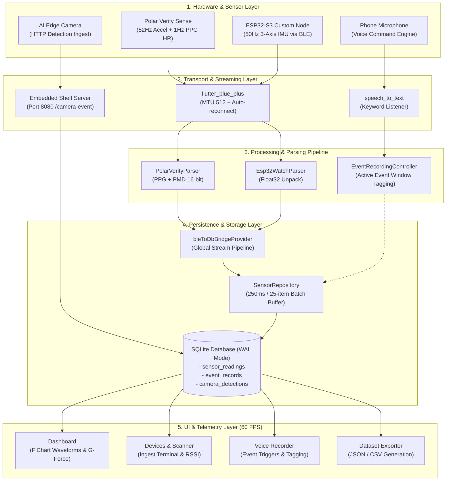
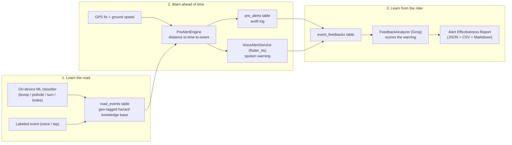

# 🏍️ Ride Sensor Capture & ML Telemetry Platform

An ultra-low-latency, multi-sensor data capture and dataset labeling application built with **Flutter**, **Drift (SQLite WAL)**, **Flutter Riverpod**, and **Bluetooth Low Energy (BLE)**.

Designed for machine learning researchers and embedded developers collecting time-synchronized vehicle dynamics, rider biomechanics, and vision telemetry for training road surface, rider behavior, and vehicle maneuver classification models.

---

## 📑 Table of Contents
1. [System Architecture & Data Flow](#-system-architecture--data-flow)
2. [Key Features](#-key-features)
3. [Project Directory Structure](#-project-directory-structure)
4. [Hardware & Communication Protocols](#-hardware--communication-protocols)
   - [Polar Verity Sense (Optical PPG & IMU)](#1-polar-verity-sense-optical-ppg--imu)
   - [ESP32-S3 Custom Watch / IMU Node](#2-esp32-s3-custom-watch--imu-node)
   - [AI Camera Ingestion Webhook](#3-ai-camera-ingestion-webhook)
5. [Database Schema & Persistence Pipeline](#-database-schema--persistence-pipeline)
6. [Prerequisites & Development Setup](#-prerequisites--development-setup)
7. [Running the Application](#-running-the-application)
8. [Testing & Verification](#-testing--verification)
9. [Dataset Export Formats (PyTorch / TensorFlow)](#-dataset-export-formats-pytorch--tensorflow)
10. [Platform Permissions & Manifest Setup](#-platform-permissions--manifest-setup)
11. [Predictive Pre-Alert & Feedback Learning Loop](#-predictive-pre-alert--feedback-learning-loop)

---

## 🏗️ System Architecture & Data Flow

The platform coordinates multiple high-frequency data streams simultaneously with zero UI thread stutter:



---

## ⚡ Key Features

* **Multi-Device BLE Synchronization**: Connects concurrently to Polar Verity Sense sensors and ESP32 nodes with automatic 512-byte MTU negotiation.
* **Resilient Connection Lifecycle**: Auto-reconnect with exponential backoff (2s, 4s, 8s, 16s, up to 20s) and a continuous 1500ms link health heartbeat monitor.
* **Crash-Safe SQLite WAL Storage**: Ingests 50Hz streams using an in-memory batch buffer committed every 250ms with zero database write locks.
* **Monotonic Sequence Indexing**: Maintains persistent per-device sequence counters (`sequenceNo`) that resume smoothly across restarts and disconnects.
* **Hands-Free Voice Event Tagging**: Start and stop labeled event windows (bumps, sharp turns, speed tests) while riding using speech keywords.
* **Predictive Pre-Alert Warnings**: Learns geo-tagged road hazards and speaks a voice warning *before* the rider reaches them, with the distance, the time-to-event and the recommended speed computed from GPS and ground speed.
* **Post-Event Feedback Learning Loop**: Prompts the rider for feedback after every event, transcribes the answer (voice or text) and scores the warning with an LLM — the resulting insights are compiled into the exported report.
* **Embedded AI Camera Server**: Built-in HTTP server (`Shelf`) listening for real-time edge vision detections from microcontrollers or Raspberry Pi over local Wi-Fi.
* **High-Performance 60 FPS Telemetry**: Optimized `FlChart` waveforms isolated with `RepaintBoundary` and zero animation duration to eliminate UI jank.
* **Direct ML Dataset Export**: Exports time-aligned telemetry with active event labels into structured JSON and CSV formats.

---

## 📁 Project Directory Structure

```text
lib/
├── app.dart                        # Root MaterialApp, navigation shell, and global permission prompts
├── main.dart                       # App entry point (WidgetsFlutterBinding & runApp)
│
├── ble/                            # Bluetooth Low Energy Subsystem
│   ├── models/
│   │   ├── ble_device_model.dart   # BleDeviceModel, DeviceType, ConnectionHealth, BleConnectionState
│   │   └── raw_sensor_data.dart    # Structured sensor reading model (HR, Accel, PPI, Gyro)
│   ├── parsers/
│   │   ├── polar_verity_parser.dart # GATT 0x2A37 (HR/PPI) & Polar PMD 0xFB005C82 Accel unpacker
│   │   └── esp32_watch_parser.dart  # Custom 13-byte byte buffer & float32 parser
│   └── services/
│       ├── ble_scanner.dart         # BLE advertisement scanner & bonded device discovery
│       ├── ble_connection_manager.dart # Connection lifecycle, MTU, auto-reconnect & packet stream
│       └── ble_permission_service.dart # Platform-specific BLE permission request handlers
│
├── camera/                         # Embedded AI Camera Module Ingestion
│   ├── camera_detection_model.dart # Detection bounding box and confidence payload models
│   ├── camera_detection_repository.dart # Drift persistence interface for camera frames
│   └── camera_ingest_server.dart   # Shelf HTTP REST server on port 8080 (/camera-event)
│
├── voice/                          # Speech Recognition & Voice Commands
│   ├── voice_command_config.dart   # Voice triggers ("start bump", "start turn", "stop event")
│   ├── voice_command_listener.dart # Continuous speech listener wrapping speech_to_text
│   └── voice_alert_service.dart    # flutter_tts wrapper for the spoken pre-alert warnings
│
├── prealert/                       # Predictive Pre-Alert System (Feature 1)
│   ├── pre_alert_engine.dart       # Pure decision engine: distance -> time-to-event -> warning
│   ├── pre_alert_service.dart      # Orchestrates GPS -> evaluation -> TTS -> audit log
│   ├── road_event_registry.dart    # Geo-tagged road hazard knowledge base (road_events)
│   └── road_event_watcher.dart     # Learns new hazards from the live on-device ML classifier
│
├── feedback/                       # Post-Event Feedback & Learning Loop (Feature 2)
│   ├── feedback_service.dart       # Prompt generation, capture, storage and LLM analysis
│   └── feedback_transcriber.dart   # One-shot speech-to-text capture for spoken answers
│
├── llm/                            # LLM Evaluation Layer (Groq only)
│   ├── groq_client.dart            # Groq chat-completions client (JSON-mode + robust parsing)
│   └── feedback_analyzer.dart      # Scores warning effectiveness; offline heuristic fallback
│
├── report/                         # Compiled Learning-Loop Reporting
│   └── alert_effectiveness_report.dart # Aggregates warnings + feedback into the final report
│
├── data/                           # Data Persistence Layer
│   ├── local_db/
│   │   ├── connection/             # Native (sqlite3) and Web database factory connectors
│   │   ├── tables/
│   │   │   ├── sensor_readings_table.dart  # Time-series IMU & HR records with eventId foreign key
│   │   │   ├── event_records_table.dart    # Labeled event windows with start/end timestamps
│   │   │   └── camera_detections_table.dart# Vision inference results
│   │   ├── database.dart           # Drift @DriftDatabase schema and migrations
│   │   └── database.g.dart         # Drift generated DAO and companion types
│   ├── models/
│   │   └── event_parameters.dart   # Bump, Turn, and Speed test physics parameter models
│   └── repositories/
│       ├── sensor_repository.dart  # SensorRepository interface
│       ├── sensor_repository_impl.dart # Batch buffered SQLite repository with in-memory caching
│       ├── export_repository.dart  # Export repository interface
│       └── export_repository_impl.dart # JSON and CSV dataset generation engine
│
├── features/                       # Presentation Screens & UI Feature Modules
│   ├── dashboard/                  # Live 50Hz waveform telemetry & G-Force dashboard
│   ├── devices/                    # BLE scanner, hardware cards & live ingest terminal
│   ├── events/                     # Voice-triggered ride labeling & event history detail
│   ├── export/                     # ML Dataset export configurations & share sheet
│   ├── prealert/                   # Predictive pre-alert banner (spoken warning mirror)
│   └── feedback/                   # Post-event feedback sheet & feedback badges
│
├── providers/                      # Riverpod Dependency Injection & State Providers
│   ├── ble_providers.dart          # Scanner, connection manager, and raw sensor streams
│   ├── db_providers.dart           # Database, repository, and BLE-to-DB bridge providers
│   ├── dashboard_providers.dart    # Rolling telemetry state notifier (8 FPS throttled)
│   ├── camera_providers.dart       # Camera server state and recent detection streams
│   ├── battery_providers.dart      # Device battery level and power mode providers
│   ├── export_providers.dart       # Dataset generation controller and filter state
│   ├── pre_alert_providers.dart    # Pre-alert service, GPS stream and road-event knowledge base
│   └── feedback_providers.dart     # Groq client, analyzer, feedback service and report
│
└── core/                           # Shared Theme, Constants, and System Services
    ├── services/
    │   ├── app_permissions_service.dart # Cold-start hardware permissions checker
    │   ├── battery_service.dart    # Battery drainage estimator
    │   └── session_health_service.dart  # Hardware alerts and packet gap monitor
    └── theme/
        └── app_theme.dart          # Dark glassmorphic color palette and styling tokens
```

---

## 📡 Hardware & Communication Protocols

### 1. Polar Verity Sense (Optical PPG & IMU)
* **Standard Heart Rate (PPG)**:
  * **Service UUID**: `0x180D` (Standard Heart Rate Service)
  * **Characteristic UUID**: `0x2A37` (Heart Rate Measurement)
  * **Payload**: Flags byte + uint8/uint16 BPM + uint16 RR-interval (PPI calculated as $\frac{\text{RR}}{1024} \times 1000\,\text{ms}$).
* **Polar Measurement Data (PMD Accelerometer)**:
  * **PMD Service UUID**: `fb005c80-02e7-f38b-9d58-b8c9f0f23d58`
  * **Control Point**: `fb005c81-02e7-f38b-9d58-b8c9f0f23d58`
  * **Data Stream**: `fb005c82-02e7-f38b-9d58-b8c9f0f23d58`
  * **Start Command**: `[0x02, 0x02, 0x00, 0x01, 0x34, 0x00, 0x01, 0x01, 0x10, 0x00, 0x02, 0x01, 0x08, 0x00]` (Requests 52Hz 8G 3-axis accelerometer streaming).

### 2. ESP32-S3 Custom Watch / IMU Node
* **Service UUID**: `0xFFE0`
* **Data Characteristic**: `0xFFE1` (Notify)
* **Binary Payload Structure (13 Bytes)**:
  | Offset | Length | Type | Description |
  |---|---|---|---|
  | `0` | 1 byte | `uint8` | Heart Rate (BPM) |
  | `1` | 4 bytes | `float32 (little-endian)` | Accelerometer X ($\text{m/s}^2$) |
  | `5` | 4 bytes | `float32 (little-endian)` | Accelerometer Y ($\text{m/s}^2$) |
  | `9` | 4 bytes | `float32 (little-endian)` | Accelerometer Z ($\text{m/s}^2$) |

### 3. AI Camera Ingestion Webhook
The app runs an internal HTTP server accessible on the phone's local network at `http://<phone-ip>:8080/camera-event`.

**Sample Ingest Payload (`POST /camera-event`)**:
```json
{
  "device_id": "esp32_cam_01",
  "timestamp_utc": "2026-08-25T10:55:00.000Z",
  "event_class": "pothole",
  "confidence": 0.94,
  "bounding_box": [120, 80, 240, 180],
  "latency_ms": 42
}
```

---

## 🗄️ Database Schema & Persistence Pipeline

All tables are managed by **Drift** backed by SQLite in **Write-Ahead Logging (WAL)** mode.

### `sensor_readings` Table
| Column | Type | Constraints | Description |
|---|---|---|---|
| `id` | `INTEGER` | Primary Key, Auto Increment | Unique record ID |
| `deviceId` | `TEXT` | NOT NULL | Device MAC or UUID |
| `deviceType` | `TEXT` | NOT NULL | `verityBand`, `watch`, `camera` |
| `sequenceNo` | `INTEGER` | NOT NULL | Monotonic counter per device |
| `timestampUtc` | `DATETIME` | NOT NULL | UTC packet arrival timestamp |
| `sensorType` | `TEXT` | NOT NULL | `hr`, `imu`, `combined`, `ppi` |
| `eventId` | `INTEGER` | Nullable, Indexed | Foreign key to active `event_records.id` |
| `heartRate` | `INTEGER` | Nullable | BPM |
| `accelX` | `REAL` | Nullable | X acceleration in $\text{m/s}^2$ |
| `accelY` | `REAL` | Nullable | Y acceleration in $\text{m/s}^2$ |
| `accelZ` | `REAL` | Nullable | Z acceleration in $\text{m/s}^2$ |
| `gyroX` | `REAL` | Nullable | X angular velocity in $\text{rad/s}$ |
| `gyroY` | `REAL` | Nullable | Y angular velocity in $\text{rad/s}$ |
| `gyroZ` | `REAL` | Nullable | Z angular velocity in $\text{rad/s}$ |
| `ppiMs` | `INTEGER` | Nullable | Peak-to-peak cardiac interval |
| `rawPayload` | `TEXT` | Nullable | Raw byte buffer backup |

### `road_events` Table (Predictive Pre-Alert Knowledge Base)
| Column | Type | Constraints | Description |
|---|---|---|---|
| `id` | `INTEGER` | PK, autoincrement | |
| `tripId` | `INTEGER` | Nullable, indexed | Trip that first reported the hazard |
| `eventType` | `TEXT` | NOT NULL | `bump`, `pothole`, `turn`, `braking`, `hazard` |
| `latitude` | `REAL` | NOT NULL | Hazard latitude |
| `longitude` | `REAL` | NOT NULL | Hazard longitude |
| `severity` | `REAL` | Nullable | Normalized 0..1 severity |
| `confidence` | `REAL` | Nullable | Model confidence 0..1 |
| `source` | `TEXT` | Default `ml` | `ml`, `camera`, `voice`, `manual` |
| `detectedAtUtc` | `DATETIME` | NOT NULL | |
| `speedKmhAtDetection` | `REAL` | Nullable | Ground speed at detection |
| `alertCount` | `INTEGER` | Default 0 | Number of pre-alerts spoken |
| `feedbackCount` | `INTEGER` | Default 0 | Number of feedback records linked |
| `lastAlertedAtUtc` | `DATETIME` | Nullable | |
| `note` | `TEXT` | Nullable | Free-form provenance note |

### `pre_alerts` Table (Spoken Warning Audit Log)
| Column | Type | Constraints | Description |
|---|---|---|---|
| `id` | `INTEGER` | PK, autoincrement | |
| `roadEventId` | `INTEGER` | Nullable, indexed | Hazard that triggered the warning |
| `tripId` | `INTEGER` | Nullable, indexed | |
| `eventId` | `INTEGER` | Nullable, indexed | Labeled event linked after the fact |
| `eventType` | `TEXT` | NOT NULL | |
| `latitude` / `longitude` | `REAL` | NOT NULL | Hazard position |
| `distanceMeters` | `REAL` | NOT NULL | Distance at alert time |
| `speedKmh` | `REAL` | NOT NULL | Speed at alert time |
| `timeToEventSeconds` | `REAL` | NOT NULL | `distance / speed` |
| `recommendedSpeedKmh` | `REAL` | NOT NULL | Advised pass speed |
| `urgency` | `TEXT` | NOT NULL | `imminent`, `warning`, `advisory` |
| `spokenText` | `TEXT` | NOT NULL | Exact TTS utterance |
| `alertedAtUtc` | `DATETIME` | NOT NULL | |
| `acknowledged` | `BOOLEAN` | Default false | Rider passed the hazard |

### `event_feedbacks` Table (Post-Event Feedback & LLM Evaluation)
| Column | Type | Constraints | Description |
|---|---|---|---|
| `id` | `INTEGER` | PK, autoincrement | |
| `eventId` | `INTEGER` | Nullable, indexed | Labeled event |
| `tripId` | `INTEGER` | Nullable, indexed | |
| `roadEventId` | `INTEGER` | Nullable, indexed | Hazard the rider reacted to |
| `preAlertId` | `INTEGER` | Nullable, indexed | Warning that preceded the event |
| `eventType` | `TEXT` | NOT NULL | |
| `prompt` | `TEXT` | NOT NULL | Question asked of the rider |
| `responseText` | `TEXT` | NOT NULL | Transcribed or typed answer |
| `responseSource` | `TEXT` | NOT NULL | `voice`, `text`, `skipped` |
| `transcriptConfidence` | `REAL` | Nullable | Speech-to-text confidence |
| `llmAnalysis` | `TEXT` | Nullable | Full JSON payload of the LLM evaluation |
| `alertEffectiveness` | `REAL` | Nullable | LLM-scored effectiveness 0..1 |
| `alertTimingAdequacy` | `TEXT` | Nullable | `too_early`, `adequate`, `too_late`, `unknown` |
| `difficultyLevel` | `TEXT` | Nullable | `none`, `mild`, `moderate`, `severe` |
| `riderSummary` | `TEXT` | Nullable | One-line LLM summary |
| `improvementSuggestion` | `TEXT` | Nullable | Concrete tuning advice |
| `analysisConfidence` | `REAL` | Nullable | |
| `analyzedByLlm` | `BOOLEAN` | Default false | False when the offline heuristic was used |
| `createdAtUtc` | `DATETIME` | NOT NULL | |
| `analyzedAtUtc` | `DATETIME` | Nullable | |

---

## 🛠️ Prerequisites & Development Setup

### Requirements
* **Flutter SDK**: `>= 3.24.0` (Dart `>= 3.5.0`)
* **Android Studio / Xcode** with Android SDK 34+ / iOS 15+
* **Physical Device** recommended for Bluetooth Low Energy testing (simulators lack full BLE central radios).

### Step-by-Step Setup

1. **Clone the Repository**:
   ```bash
   git clone https://github.com/your-username/ride_sensor_capture.git
   cd ride_sensor_capture
   ```

2. **Install Flutter Dependencies**:
   ```bash
   flutter pub get
   ```

3. **Generate Drift Database Code**:
   ```bash
   dart run build_runner build --delete-conflicting-outputs
   ```

4. **Verify Analysis & Test Suite**:
   ```bash
   flutter analyze
   flutter test
   ```

---

## 🚀 Running the Application

### Running on a Connected Android / iOS Device
```bash
flutter run
```

### Running with Release Performance Mode
```bash
flutter run --release
```

### Running with the Groq LLM Evaluator
The post-event feedback analysis uses Groq as its LLM backend. Supply the API key as a
compile-time define (the app works without it, falling back to the offline heuristic):
```bash
flutter run --dart-define=GROQ_API_KEY=gsk_xxxxxxxxxxxxxxxx
```

---

## 🧪 Testing & Verification

The repository contains **223 automated unit and integration tests** covering:
* BLE parsing and model validation
* Monotonic sequence number continuation across database reconnects
* Camera detection payload verification and bounds checking
* Drift database batch persistence
* ML JSON and CSV dataset export formatting
* Geodesic maths (haversine distance, bearings, dead reckoning)
* Predictive pre-alert windowing, time-to-event and recommended-speed calculations
* Pre-alert issuing, de-duplication, audit logging and event linking
* Groq client request construction, JSON extraction and error classification
* Post-event feedback capture, offline heuristic analysis and LLM analysis fallbacks
* Alert-effectiveness report compilation and the new export files
* Pre-alert banner and feedback sheet widget behaviour

Execute the test suite with:
```bash
flutter test
```

Static analysis:
```bash
flutter analyze
```

---

## 📦 Dataset Export Formats (PyTorch / TensorFlow)

The Export screen allows researchers to export collected rides into formats ready for Python data pipelines:

### 1. JSON Export Schema (`.json`)
```json
{
  "export_version": "1.0",
  "generated_at_utc": "2026-08-25T11:00:00.000Z",
  "mode": "events_only",
  "events": [
    {
      "id": 1,
      "event_type": "bump",
      "start_timestamp_utc": "2026-08-25T10:55:10.000Z",
      "end_timestamp_utc": "2026-08-25T10:55:14.200Z",
      "trigger_phrase": "start bump",
      "computed_parameters": {
        "bump": { "peak_g_force": 2.84, "duration_ms": 4200 }
      },
      "sensor_readings": [
        {
          "seq": 1042,
          "device_id": "C8:3F:2A:11:22:33",
          "timestamp_utc": "2026-08-25T10:55:10.020Z",
          "hr": 132,
          "accel_x": 0.42,
          "accel_y": -1.18,
          "accel_z": 12.45
        }
      ],
      "camera_detections": []
    }
  ]
}
```

### 2. Time-Series CSV Export Schema (`.csv`)
```csv
id,device_id,device_type,sequence_no,timestamp_utc,sensor_type,event_id,heart_rate,accel_x,accel_y,accel_z,gyro_x,gyro_y,gyro_z,ppi_ms
1,C8:3F:2A:11:22:33,verityBand,1042,2026-08-25T10:55:10.020Z,combined,1,132,0.42,-1.18,12.45,,,465
```

### 3. Pre-Alert & Feedback Export Schemas

`pre_alerts_export.csv` — every spoken warning:
```csv
pre_alert_id,road_event_id,trip_id,event_id,event_type,alerted_at_utc,latitude,longitude,distance_meters,speed_kmh,time_to_event_seconds,recommended_speed_kmh,urgency,spoken_text,acknowledged
1,1,1,7,bump,2026-08-25T10:55:00.000Z,12.9716000,77.5946000,400.0,90.00,16.00,40.0,warning,"Speed bump ahead, 400 metres, 16 seconds. Reduce to 40.",false
```

`alert_effectiveness_export.csv` — every warning joined with the LLM-scored rider feedback:
```csv
pre_alert_id,event_id,road_event_id,event_type,alerted_at_utc,distance_meters,speed_kmh,time_to_event_seconds,recommended_speed_kmh,urgency,spoken_text,response_source,response_text,alert_effectiveness,alert_timing_adequacy,difficulty_level,rider_summary,improvement_suggestion,analyzed_by_llm
1,7,1,bump,2026-08-25T10:55:00.000Z,400.0,90.00,16.00,40.0,warning,"Speed bump ahead, ...",voice,"Perfect timing, I had enough time to slow down.",0.880,adequate,mild,"Rider slowed down comfortably.","Keep the current 20-second warning window for bumps.",true
```

---

## 🔒 Platform Permissions & Manifest Setup

### Android (`android/app/src/main/AndroidManifest.xml`)
* `android.permission.BLUETOOTH_SCAN`
* `android.permission.BLUETOOTH_CONNECT`
* `android.permission.ACCESS_FINE_LOCATION`
* `android.permission.RECORD_AUDIO`
* `android.permission.FOREGROUND_SERVICE`
* `android.permission.WAKE_LOCK`
* `<queries>` entry for `android.intent.action.TTS_SERVICE` (required on Android 11+ so the
  predictive pre-alert can use the on-device Text-To-Speech engine)

### iOS (`ios/Runner/Info.plist`)
* `NSBluetoothAlwaysUsageDescription`
* `NSBluetoothPeripheralUsageDescription`
* `NSLocationWhenInUseUsageDescription`
* `NSLocationAlwaysAndWhenInUseUsageDescription`
* `NSMicrophoneUsageDescription`
* `NSSpeechRecognitionUsageDescription`

### Groq LLM (optional, compile-time)
* `GROQ_API_KEY` — the GroqCloud API key (`--dart-define=GROQ_API_KEY=...`)
* `GROQ_MODEL` — optional model override (default `openai/gpt-oss-120b`)
* `GROQ_BASE_URL` — optional base URL override (proxies / mock servers)

Place these in a local `.env` file (git-ignored) and use `./tool/run.sh` to have them
injected automatically. Without a key the app stays fully functional: the feedback
analyzer falls back to the offline heuristic evaluator.

---

## 📣 Predictive Pre-Alert & Feedback Learning Loop

This module turns the app from a *reactive* recorder into a *proactive* safety assistant:
it warns the rider about a road hazard **before** they physically reach it, and then
measures how well that warning actually worked.



### 2.1 The warning maths

`lib/prealert/pre_alert_engine.dart` is a **pure, side-effect free** decision engine so the
safety-critical arithmetic is fully unit-testable.

| Quantity | Formula |
|---|---|
| Distance | Haversine great-circle distance to the hazard |
| Time-to-event | `timeToEvent = distance / speed` (speed in m/s) |
| Warning window | Speak when `2 s <= timeToEvent <= 20 s` |
| Urgency | `imminent` <= 4 s, `warning` <= 9 s, otherwise `advisory` |
| Pass speed | Linear interpolation between 55 km/h (harmless) and 25 km/h (severe) by hazard severity |
| Recommended speed | Pass speed when the runway suffices, otherwise the analytic maximum speed reachable given `reactionTime` (1.2 s) and `maxDeceleration` (3.5 m/s²) |

**Worked example (the spec case).** A bump is known to be **400 m ahead** and the rider is doing
**90 km/h** (25 m/s):

```
timeToEvent = 400 m / 25 m/s = 16 s      -> inside the warning window -> speak now
passSpeed   = 55 - 30 x 0.5 (severity)  = 40 km/h
runway      = 400 m  >=  (25^2 - 11.1^2)/(2 x 3.5) + 25 x 1.2 = 113.7 m  -> comfortable
spoken      -> "Speed bump ahead, 400 metres, 16 seconds. Reduce to 40."
```

The same calculation is applied to **every** event type (bumps, potholes, sharp turns,
braking zones and generic hazards) — only the wording and the pass speed differ.

### 2.2 The road-event knowledge base

| Table | Purpose |
|---|---|
| `road_events` | Geo-tagged hazards (`latitude`, `longitude`, `eventType`, `severity`, `confidence`, `source`, `alertCount`, `feedbackCount`) |
| `pre_alerts` | Audit log of every spoken warning (`distanceMeters`, `speedKmh`, `timeToEventSeconds`, `recommendedSpeedKmh`, `urgency`, `spokenText`) |
| `event_feedbacks` | The rider's answer plus the LLM evaluation (`responseText`, `alertEffectiveness`, `alertTimingAdequacy`, `difficultyLevel`, `improvementSuggestion`, `analyzedByLlm`) |

Hazards enter the knowledge base from three places:

1. **Live on-device ML** (`RoadEventWatcher`) — a confident `severeBump` / `sharpTurn`
   classification is geo-tagged with the current GPS fix.
2. **Labeled events** (`EventRecordingController`) — completing a voice- or tap-labelled
   event registers it as a hazard.
3. **Manual seeding** via the `RoadEventRegistry` API.

On every subsequent pass the engine finds the hazards ahead of the rider, computes the
warning and speaks it through the TTS engine.

### 2.3 The feedback loop

When an event is saved, the rider is asked a contextual question:

| Event type | Question |
|---|---|
| Bump / Pothole | "How smooth was the bump?" |
| Turn | "Did you face any difficulty navigating that turn?" |
| Braking / Speed | "Did you face any difficulty navigating that event?" |

The answer can be given by voice (one-shot dictation via `speech_to_text`, transcribed) or
typed, with one-tap quick replies. The answer — together with the telemetry of the warning
that preceded the event (distance, speed, time-to-event, recommended speed, severity) — is
sent to the LLM evaluator, which returns structured JSON:

```json
{
  "alertEffectiveness": 0.86,
  "alertTimingAdequacy": "adequate",
  "difficultyLevel": "mild",
  "riderSummary": "The rider had enough time to slow down comfortably.",
  "improvementSuggestion": "Keep the current 20-second warning window for bumps.",
  "confidence": 0.91
}
```

**Groq is the only LLM provider used.** The key is supplied at build/run time:

```bash
# Option 1 — the .env file (recommended, key stays out of your shell history)
cp .env.example .env      # then put your key in .env
./tool/run.sh             # loads .env and injects the dart-defines
./tool/run.sh build apk   # ...or build a release APK the same way

# Option 2 — pass the define directly
flutter run --dart-define=GROQ_API_KEY=gsk_xxxxxxxxxxxxxxxx

# Optional model override (default: openai/gpt-oss-120b)
flutter run --dart-define=GROQ_API_KEY=gsk_xxx --dart-define=GROQ_MODEL=openai/gpt-oss-20b
```

`.env` is git-ignored and never committed. To confirm the live LLM path works:

```bash
dart run tool/verify_llm.dart
# -> prints the structured evaluation the app would store
```

> **Offline behaviour.** When no API key is configured (or the API call fails) the analyzer
> degrades gracefully to a deterministic keyword heuristic, so the app keeps working end to
> end without a network connection. The `analyzedByLlm` column records which path was used.

### 2.4 The compiled report

`lib/report/alert_effectiveness_report.dart` aggregates every warning and its feedback
into a single verdict that is included in the export:

* `alert_effectiveness_export.csv` — one row per warning, joined with the scored feedback.
* `pre_alerts_export.csv` — the raw audit log of every spoken warning.
* `alert_effectiveness_report_<timestamp>.md` — a human-readable report (summary, timing
  breakdown, per-event-type effectiveness, compiled insights, per-alert detail).
* `ride_dataset_ml_<timestamp>.json` — now at `export_version: 2.1`; every event carries a
  `pre_alert` block and a `feedback` list, and the file carries a top-level
  `pre_alert_effectiveness` report object.

The Export screen also shows a live "Pre-Alert Effectiveness" card with the mean
effectiveness, the average warning lead time and the compiled insights.

---

## 👨‍💻 Contributing

1. Create a feature branch: `git checkout -b feature/new-sensor-protocol`
2. Commit your changes: `git commit -m "feat: add support for Garmin BLE cadence protocol"`
3. Run tests and static analysis: `flutter test && flutter analyze`
4. Push to the branch: `git push origin feature/new-sensor-protocol`
5. Open a Pull Request.

---

## 📄 License
This project is private and intended for research & development.
